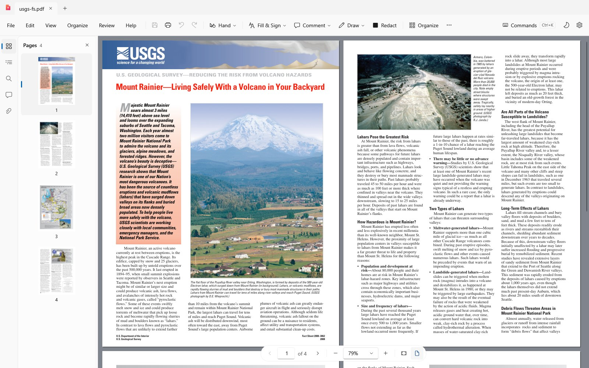
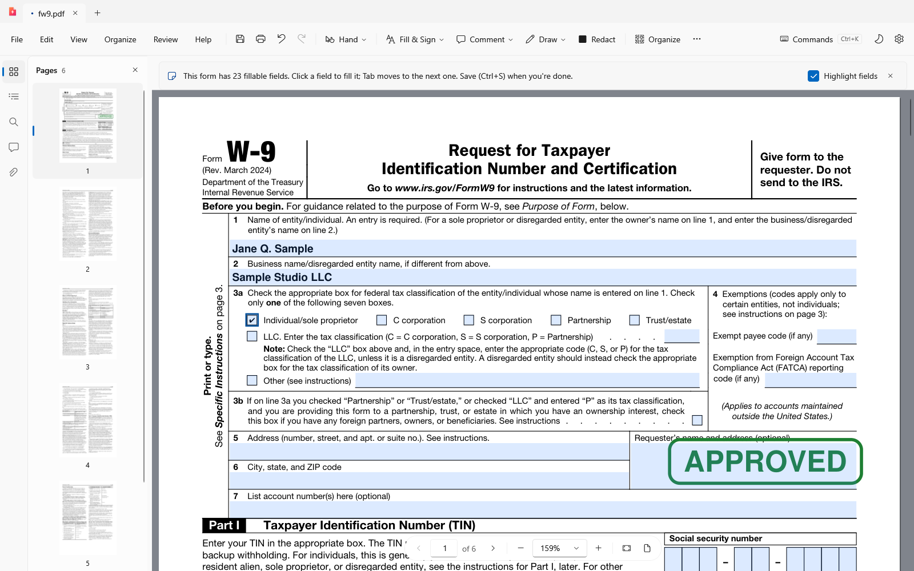
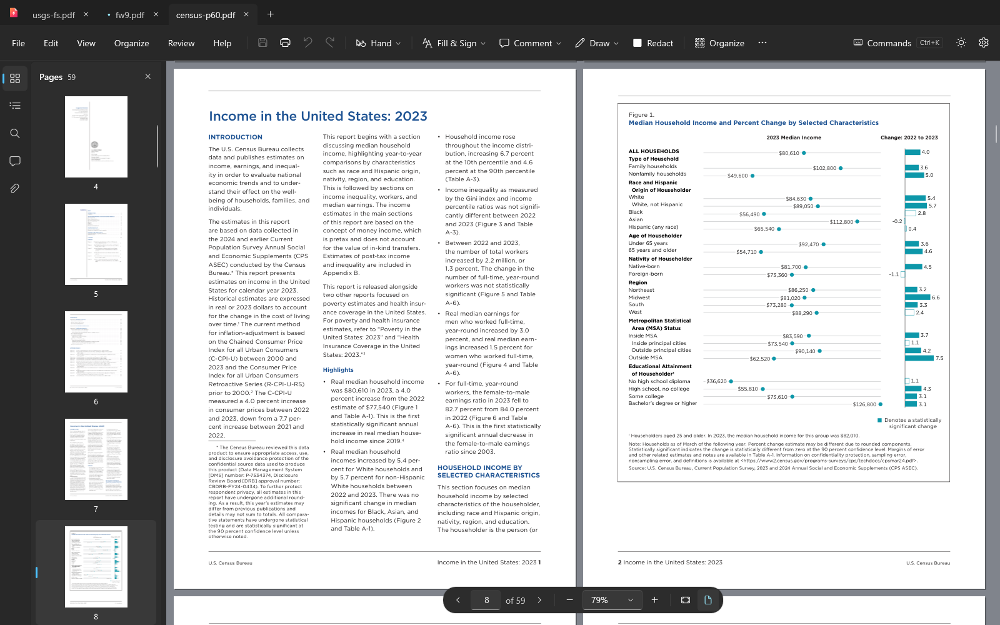
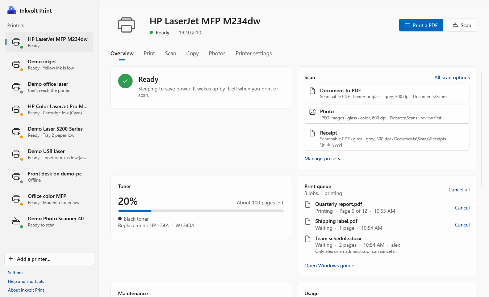
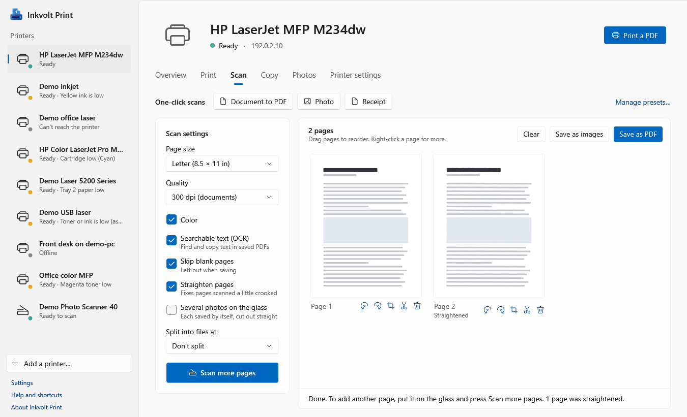

# Inkvolt: free, private PDF and printer apps for Windows

**Inkvolt PDF** is a PDF reader and editor. **Inkvolt Print** handles your printers and scanners. Both are free and open
source, with **no account, no ads, no telemetry and no cloud**: your files stay on your PC.

<p>
  <a href="https://apps.microsoft.com/detail/9MXDTSFJ9W28"><b>Get Inkvolt PDF</b></a> ·
  <a href="https://apps.microsoft.com/detail/9PNR76HJ62SK"><b>Get Inkvolt Print</b></a> (Microsoft Store, Windows 10 and 11, x64 and native ARM64) ·
  <a href="https://github.com/gabandres/inkvolt/releases/tag/pdf-mac-v1.3.0">Inkvolt PDF for Mac</a> ·
  <a href="https://bermudezsystems.com/products/inkvolt/">Website</a>
</p>

```powershell
winget install 9MXDTSFJ9W28   # Inkvolt PDF
winget install 9PNR76HJ62SK   # Inkvolt Print
```

```sh
brew install --cask gabandres/inkvolt/inkvolt-pdf   # Inkvolt PDF for Mac (Apple silicon, macOS 15 or later)
```



## Inkvolt PDF

Everything below is free, without a watermark, a trial or a sign-in:

- **Read**: tabs, continuous or two-page views, fast search, bookmarks, split view, dark pages for night reading, Read
  Aloud.
- **Fill & Sign**: fill any form, type anywhere on a page, add a handwritten signature or initials.
- **Digital signatures**: sign with a certificate, smart card or Windows Hello, add a trusted timestamp, verify existing
  signatures.
- **Comment and draw**: highlight, notes, stamps, pen, shapes, arrows, text boxes, callouts, measurements.
- **Edit text and images** on the page; links, headers and footers, page numbers, watermarks.
- **Organize pages**: reorder, rotate, insert, extract, split, crop and merge files.
- **Redact for real**: the text and images underneath are removed, not just covered, then checked for leftovers. Sanitize
  hidden data.
- **OCR, export and convert**: make scans searchable (on your PC, with Windows' own recognizer), export to Word or Excel,
  make PDFs from Office files, web pages and images, PDF/A, password protection, reduce file size.
- **Create forms, compare two versions, run batches** on many files, and check accessibility (PDF/UA).
- **Optional AI assistant, off by default**: bring your own (Ollama, LM Studio, or a service with your own key). Inkvolt
  shows exactly what text is sent, and where, before anything goes.

| Fill and sign forms | Dark theme |
|---|---|
|  |  |

## Inkvolt Print

A lean replacement for heavy printer apps: no printer-maker account, no cloud, no background services.

- See whether the printer is ready, ink or toner levels, paper problems and usage, live.
- Finds network printers by itself (HP, Canon, Epson, Brother and any AirPrint, Mopria or IPP Everywhere printer); USB
  printers already set up in Windows show up too.
- Scan from the glass or the feeder to a searchable PDF or JPEG, several pages at a time, with cropping, straightening,
  blank-page skipping and one-click presets.
- Copy (ID cards too), print photos and PDFs, manage the print queue, fix a paused or offline printer.

| Printer status | Scanning |
|---|---|
|  |  |

## How Inkvolt compares

Free versions, checked on each vendor's own pages in October 2026. ✅ free · ❌ paid upgrade or not offered · – not
verified.

| | **Inkvolt PDF** | Adobe Acrobat Reader | Foxit PDF Reader | PDF-XChange Editor (free) | PDFgear |
|---|---|---|---|---|---|
| Price | **Free** | Free; editing from $14.99/month | Free; PDF Editor $209.99 | Free; licensed features from $62 | Free |
| Edit text on the page | ✅ | ❌ (Standard, Pro) | ❌ (PDF Editor) | Partly | ✅ |
| OCR (searchable scans) | ✅ on your PC | ❌ (Pro) | – | Basic | ✅ |
| Redaction that removes content | ✅ | ❌ (Pro) | – | – | – |
| Organize and merge pages | ✅ | ❌ (Standard, Pro) | – | ❌ (stamped until licensed) | ✅ merge |
| Export to Word and Excel | ✅ | ❌ (Standard, Pro) | – | – | ✅ |
| Create form fields | ✅ | ❌ (Standard, Pro) | – | ❌ (Plus) | ❌ |
| Compare two versions | ✅ | ❌ (Pro) | – | ❌ (Plus) | – |
| No demo stamps on any feature | ✅ | – | – | ❌ | ✅ |
| Usage data collection | **None** | – | Yes, opt-out | – | Usage, device and IP data, Google Analytics |
| Open source | ✅ AGPL-3.0 | ❌ | ❌ | ❌ | – |
| Native ARM64 (Snapdragon PCs) | ✅ | ❌ (emulated) | – | ✅ | – |

| | **Inkvolt Print** | HP app (formerly HP Smart) |
|---|---|---|
| Account | **None, ever** | Needed for "full functionality"; Mobile Fax and remote printing need an HP account |
| Promotions | **None** | Instant Ink links, Adobe Express Premium offer |
| Printer brands | HP, Canon, Epson, Brother and any AirPrint, Mopria or IPP Everywhere printer | HP |

<details>
<summary>Sources</summary>

[Acrobat pricing](https://www.adobe.com/acrobat/pricing.html) ·
[Acrobat Reader](https://www.adobe.com/acrobat/pdf-reader.html) ·
[Acrobat on ARM64](https://community.adobe.com/questions-9/adobe-acrobat-native-windows-on-arm-arm64-support-1633747) ·
[Foxit PDF Reader](https://www.foxit.com/pdf-reader/) ·
[Foxit PDF Editor](https://www.foxit.com/pdf-editor/) ·
[Foxit privacy policy](https://www.foxit.com/privacy.html) ·
[PDF-XChange Editor](https://www.pdf-xchange.com/product/pdf-xchange-editor) ·
[PDF-XChange features](https://www.pdf-xchange.com/product/pdf-xchange-editor/features) ·
[PDF-XChange demo stamps](https://www.pdf-xchange.com/knowledgebase/186-Remove-Demo-stamps-from-my-Document-and-why-are-they-there) ·
[PDFgear](https://www.pdfgear.com/) ·
[PDFgear privacy policy](https://www.pdfgear.com/privacy/) ·
[HP app](https://www.hp.com/us-en/hp-app/overview.html).
Something out of date? [Open an issue](https://github.com/gabandres/inkvolt/issues).

</details>

## Support Inkvolt

Inkvolt is made by one developer, [Bermudez Systems](https://bermudezsystems.com). If it saves you a subscription, star
the repository, leave a rating in the Microsoft Store, or tell a friend. Bugs and ideas:
[issues](https://github.com/gabandres/inkvolt/issues).

*Inkvolt is independent and not affiliated with Adobe, Foxit, PDF-XChange, PDFgear, HP, Canon, Epson or Brother. Their
names are trademarks of their owners, used here only for comparison.*

## For developers

Two Windows apps in one repository. Each is its own app with its own Microsoft Store listing; they share code and
install together.

| Folder | What | License |
|---|---|---|
| [`pdf/`](pdf/README.md) | **Inkvolt PDF**: a fast PDF viewer, editor and page organizer (.NET 10 WPF + MuPDF) | AGPL-3.0 (MuPDF requires it) |
| [`print/`](print/README.md) | **Inkvolt Print**: a lean, private app for your printers and scanners (status, ink or toner, scan, copy, print) | MIT |
| `shared/` | `InkvoltPrint.Core` (protocols: eSCL, IPP, LEDM, CDM, SNMP, scan options, remembered printers) and `InkvoltPrint.Windows` (discovery, Windows queues, WIA): used by both apps; tested by `print/tests` | MIT |
| `packaging/` | `pack-msix.ps1`: MSIX packages and Store upload files for either app (`-App Pdf` or `-App Print`) | MIT |
| [`mac/`](mac/README.md) | **Inkvolt for macOS**, in planning: native Swift, Inkvolt Print first (Mac App Store), then Inkvolt PDF | MIT (Inkvolt PDF's Mac app will be AGPL) |

The license of each folder is in its `LICENSE`; the top-level scripts are MIT (see [LICENSE](LICENSE)). Inkvolt PDF's
AGPL applies to Inkvolt PDF as distributed (the MIT libraries in it stay MIT on their own); Inkvolt Print ships no AGPL
code.

### Build

```powershell
git clone https://github.com/gabandres/inkvolt.git
cd inkvolt
dotnet build Inkvolt.slnx    # both apps, the shared libraries and the tests
dotnet test Inkvolt.slnx
```

Needs the .NET 10 SDK on Windows 10 (19041) or later, x64 or ARM64. Each app also builds on its own from its folder
(`pdf/InkvoltPdf.slnx`, `print/InkvoltPrint.slnx`). Settings shared by every project are in `Directory.Build.props`;
`pdf/Directory.Build.props` adds Inkvolt PDF's own (embedded PDBs, ARM64 by default).

### Install both

```powershell
pwsh -File install-suite.ps1             # publishes both, installs to %LOCALAPPDATA%\Programs\Inkvolt\InkvoltPdf and \InkvoltPrint
pwsh -File install-suite.ps1 -NoBuild    # install the existing publish outputs (pdf/publish, print/publish)
pwsh -File install-suite.ps1 -Uninstall  # removes only what it added, and puts back registry values it replaced
```

It adds a Start Menu folder "Inkvolt" with both apps ("Inkvolt PDF", "Inkvolt Print"), App Paths entries (`InkvoltPdf.exe`,
`InkvoltPrint.exe`: how each app finds the other) and Inkvolt PDF's "Open with" entries. Registry keys are only created
when missing (never re-created, which would wipe their values); each value set is recorded, with the value it replaced,
in `Inkvolt\inkvolt-suite.json` for `-Uninstall`. `pdf/install.ps1` still installs Inkvolt PDF on its own.

Both apps keep their settings in `%LOCALAPPDATA%\InkvoltPdf` and `\InkvoltPrint`. On first start each moves its folder
over from the name it had before the rename, once; Inkvolt Print also moves its saved printer passwords in Credential
Manager. The installers don't remove an install made under the old names: uninstall that with the old scripts first.

### Microsoft Store

```powershell
pwsh -File packaging/pack-msix.ps1 -App Pdf      # → pdf/publish/msix
pwsh -File packaging/pack-msix.ps1 -App Print    # → print/publish/msix
```

Partner Center values, Store policy notes and listing drafts: [`pdf/packaging/README.md`](pdf/packaging/README.md),
[`print/packaging/README.md`](print/packaging/README.md).

### History

Inkvolt PDF (formerly PdfDesk, `github.com/gabandres/inkvolt-pdf`) and Inkvolt Print (formerly PrintDesk,
`github.com/gabandres/inkvolt-print`) were separate repositories until October 2026; both histories are kept here
(`git log -- pdf/…`, `git log -- print/…`; `--follow` for files that moved to `shared/`).
